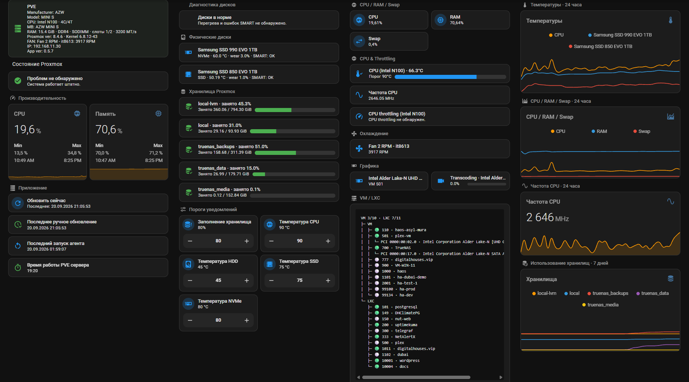

# DigitalHouses PVE Agent

[](https://github.com/DigitalHouses/home-assistant-apps/actions/workflows/validate.yml)
[](../LICENSE)


Native Linux agent for **Proxmox VE 8.x** that publishes host, CPU, memory, storage, disk/SMART, GPU, fan, VM/LXC and optional NUT/UPS observability to Home Assistant through MQTT Discovery.

## Native CLI and unattended installation (development source)

The source tree implements the [DigitalHouses Linux Agent Management Standard](../docs/standards/DH_LINUX_AGENT_MANAGEMENT_STANDARD.md). The released 0.5.82 build does **not** yet contain these changes; verify a future tagged release before installation.

Root/admin commands after installing a release that includes the feature:

```bash
/usr/local/bin/dh-pve-agent status
/usr/local/bin/dh-pve-agent restart
/usr/local/bin/dh-pve-agent set mqtt_ip=192.168.11.242 mqtt_port=1883
/usr/local/bin/dh-pve-agent set mqtt_password  # hidden terminal prompt
/usr/local/bin/dh-pve-agent help
cat /root/dh-pve-agent.txt
```

The CLI reads the single existing INI at `/etc/digitalhouses_pve_agent/digitalhouses_pve_agent.conf`. Batch updates validate the entire effective config, preserve unrelated settings and metadata, and restart an active agent at most once. UPS safety denies unsafe restarts. The password value must not appear in process arguments. To send it from automation, use `mqtt_password=-` with redirected stdin and Ansible `no_log: true`.

`install.sh` accepts `--non-interactive`, repeated `--set key=value`, and `--mqtt-password-stdin` / `--ups-command-password-stdin` to read secret lines. It also supports an already provisioned native INI with no extra installer-specific schema. For example (secrets supplied by protected stdin, not an argument):

```bash
./install.sh --non-interactive --set mqtt_ip=192.168.11.242 \
  --set mqtt_port=1883 --set mqtt_username=mqttuser --mqtt-password-stdin
```

The UPS battery-test and beeper controls use bounded native NUT protocol messages, not upscmd -p arguments, to avoid exposing the NUT command password via the process list. Only previously allowed actions remain available.

The installed `/root/dh-pve-agent.txt` guide is mode `0600`. The existing MQTT Discovery device adds `sensor.dh_pve_agent_hostname` and `sensor.dh_pve_agent_ip` without renaming existing entities. If MQTT is unavailable, local PVE collectors and UPS/NUT protection continue; Paho retries every 60 seconds, with a 5-second connection timeout. Local `status` uses an atomic volatile snapshot under `/run/digitalhouses_pve_agent`, never launches QGA/SMART reads, and visibly marks unavailable or stale values. An agent release is not ready until live Proxmox/NUT acceptance checks pass.

[Installation / update](#installation--update) · [Changelog](CHANGELOG.md) · [Engineering docs](../docs/digitalhouses_pve_agent/) · [Issues](https://github.com/DigitalHouses/home-assistant-apps/issues)

The canonical product and runtime identity is **DigitalHouses PVE Agent** / `digitalhouses_pve_agent`: systemd service `digitalhouses_pve_agent.service`, filesystem roots under `/opt/digitalhouses/digitalhouses_pve_agent`, `/etc/digitalhouses_pve_agent` and `/var/lib/digitalhouses_pve_agent`, MQTT base `DigitalHouses/Global/digitalhouses_pve_agent/<instance>`, and Home Assistant entity prefix `dh_pve_agent_*`. Version 0.5.30 performs the corrected one-time controlled migration from the former `dh_pve_app` / `dh_app_pve_*` runtime, including deterministic cleanup of retained data owned by the legacy MQTT instance namespace.

Current source release: `VERSION` is `0.5.82`.

UPS Debug logging: `switch.dh_pve_agent_ups_debug` (MQTT Discovery, default OFF)
records raw NUT observations every 2 seconds when enabled. It disables itself
72 hours after switching ON, including across agent/PVE restarts and without
HA/MQTT connectivity. The append-only JSON Lines trace is stored in
`/var/lib/digitalhouses_pve_agent/dh_ups_debug.log`, with five 10 MiB
rotated backups (approximately 60 MiB maximum). It records the initiating
values before a software FSD attempt, but never changes the NUT primary or
software shutdown guards. The user can switch it OFF at any time in HA.


VM USB passthrough configuration is resolved by the same read-only native Proxmox helper as PCI: `PVE::JSONSchema` and `PVE::QemuServer::USB`, including USB Resource Mapping. USB physical inventory stays sysfs-based; exact USB ports are assigned first, and ambiguous VID:PID matches remain unassigned until they can be identified without guessing. Errors are exposed as `usb_inventory_errors` and previous confirmed mappings are retained. No additional timer or MQTT entity identities.

PCI passthrough inventory uses the read-only bundled `bin/pve-pci-inventory` helper, invoking Proxmox's native Perl APIs at STATIC topology refresh / targeted VM rescan only. The helper resolves all functions of a PCI slot and unambiguous PCI Resource Mappings without parsing VM `hostpci` strings in Python. Ambiguous mapping alternatives and Proxmox API failures are logged and retained in the topology payload as `pci_inventory_errors`; previous disk/PCI identities are preserved rather than falsely deleted. PVE 8.4 validated; PVE 9 requires a live smoke test before declaring verified compatibility.

## Home Assistant dashboard



Example of the DigitalHouses PVE Agent dashboard in Home Assistant.

## Architecture

The App is the source of truth for acquisition, calculations, thresholds, problem state, topology, UPS interpretation and effective policy. Home Assistant is a light client for UI, explicit Recorder history, notifications and user configuration input.

Normal data-source priority on Proxmox VE 8.x is:

1. `/proc` and `/sys`;
2. `/etc/pve` configuration and PVE-maintained cache/status files;
3. a subprocess only when there is no suitable cheap source;
4. `pvesh`/API actions only for rare or on-demand work.

A failed cheap parser/source is reported as unavailable/problem state. The daemon does not fall back permanently to heavy `pvesh`, `qm`, `pct`, `pvesm` or QGA polling loops.

## Fixed collection cadence

Collection cadence is App-owned and does not accelerate because a resource becomes busy:

- `FAST` — 10 s: CPU, temperature/frequency, RAM, Swap, fans;
- `UPS` — 10 s: NUT runtime data;
- `SLOW` — 60 s: storage usage, disk temperature, GPU inventory/temperature, VM/LXC runtime, host runtime diagnostics and `/etc/pve/.version` check;
- `HEALTH` — 1 h: full SMART/wear and genuinely heavy health diagnostics;
- `STATIC` — startup and detected PVE configuration-version changes. Manual Refresh is the explicit full refresh path: it rebuilds topology, rescans QGA-backed passthrough storage, and sequentially refreshes every PVE collector, including guests, host, CPU, memory, storage, fans, SMART/health, disk temperature and GPU inventory/temperature. If UPS is configured, the same main Refresh request also refreshes UPS state; the dedicated UPS Refresh remains available for UPS-only refresh.

The legacy `[ups] poll_interval_seconds` configuration key is accepted only for upgrade compatibility and is ignored; UPS collection remains fixed at 10 seconds.

Manual Refresh executes the requested recovery collection sequentially rather than creating a parallel burst. If the Agent started while a VM QEMU Guest Agent was unavailable, restore the guest first and press Refresh to rebuild passthrough disk inventory and SMART state without restarting the PVE Agent. Manual PVE Refresh, UPS Refresh and UPS Scan publish retained operation state (`idle`, `updating`, `error`) with start/finish timestamps, duration and error detail so Home Assistant can show real progress without timers. For the main Refresh button, `sensor.dh_pve_agent_refresh_state` remains `updating` across the complete PVE + configured-UPS flow; `sensor.dh_pve_agent_last_refresh` advances only after the complete flow succeeds.

## OOM and Memory Pressure diagnostics

Passive, read-only memory diagnostics sample the host and running LXC guests every 10 minutes by default. Set `number.dh_pve_agent_memory_check_interval` in Home Assistant to 10, 20, 30, 40, 50 or 60 minutes. Kernel OOM messages and LXC cgroup-v2 OOM counters are always recorded without a threshold. PSI `full total` becomes a Home Assistant incident only when the increase reaches at least 5% of the actual elapsed observation window (30 seconds per 10 minutes, 180 seconds per hour); consecutive nonzero intervals are merged into one episode once the threshold is reached. Events seen only inside a VM's guest OS cannot be detected by the PVE host.

The agent retains 30 days of events **and every PSI interval delta, including zero and small delays**, at `/var/lib/digitalhouses_pve_agent/memory_diagnostics.json`. Raw PSI samples are local-only and never published to Home Assistant. Pressure events recorded before 0.5.57 remain in local 30-day history but are excluded from the new HA incident table because their severity was not verified against an elapsed observation window. `sensor.dh_pve_agent_memory_history` publishes the newest 60 events, the full count and a truncation indicator to avoid oversized Home Assistant attributes; an unreadable source is marked unknown rather than treated as healthy. Example dashboard card: [Memory events](examples/dh_pve_agent_memory_diagnostics_card.yaml). No guest commands, memory tuning, alerts or restart actions are performed.

## Agent status cards (UI v3)

The Russian Dashboard uses four independent Mushroom status cards:
**Problems**, **Updates**, **Refresh**, and **Restart**. The first card
remains visible and lists numbered PVE and UPS/NUT problems with suggested
actions, including an offline/unavailable agent. The other three cards are
conditionally visible only while their task is active (or, for Updates,
while a newer stable release is available). Existing control chips remain
separate, with confirmation on Update and Restart.

The [drop-in cards fragment](examples/dh_pve_agent_status_cards_ru.yaml)
contains the five sibling items (four status cards and the controls).
The [standalone card](examples/dh_pve_agent_card_ru.yaml) wraps those items
in a vertical stack; the [full Russian Dashboard](examples/dh_pve_agent_dashboard_ru.yaml)
contains the exact same cards under its first section.

Only existing MQTT entities are used: the operation state, `started_at`,
stable versions, shutdown readiness, UPS state, and PVE problems. No extra
MQTT traffic, JS polling, `button-card`, timers, or release publication
date. Relative timestamps use HA's native `time_since()` template,
which refreshes approximately once per minute (not every second). A short
MQTT availability gap during Restart can momentarily hide its conditional
status; Problems then indicates the agent is offline. No operation is
reported as successful until the agent confirms completion.

The app-side operation contract still publishes a five-second success
result and persists errors for Problems to display; update and restart
safety preflights are unchanged.

## Update from Home Assistant

The PVE Agent exposes two non-retained MQTT commands in the existing DH PVE device:

- `button.dh_pve_agent_check_updates` checks GitHub Releases on demand.
- `button.dh_pve_agent_update` installs a verified newer, stable, published PVE Agent release.
- `binary_sensor.dh_pve_agent_update_available` is ON/OFF/unknown.
- `sensor.dh_pve_agent_latest_version` shows the latest release version (unknown if GitHub is unreachable).
- `sensor.dh_pve_agent_update_status` shows checking, queued, downloading, installing, verifying, rolling_back, idle, completed or error; details include the last error, check time, and separate historical `installation_status`/`installation_error`. After a fresh successful check, `idle` and `update_available=off` mean the installed version is current: a previous installation's `completed` must not override the latest check.

A release check runs at startup and every 24 hours, in a background thread. No automatic installation occurs, and unrelated monorepo products, prereleases, drafts, tags without published GitHub Releases, branches and arbitrary commits are never offered.

Updates are carried out by a separate `digitalhouses_pve_agent-update.service` unit. Its small independent runner lives in `/usr/local/libexec`, outside the source tree being replaced. Before installation it verifies the Release and live NUT/UPS power, then copies the old agent runtime, configuration and units into `/var/lib/digitalhouses_pve_agent/update-backup`. A failed install/startup restores the previous installation. An interrupted transaction is recovered by the separate
`digitalhouses_pve_agent-update-recover.service`, required and started
before the protected agent service, without relaxing its filesystem sandbox. The last backup is retained for recovery. The updater never shuts down or restarts PVE, VMs, containers or NUT. It necessarily restarts **the agent process**, briefly interrupting monitoring and application-owned UPS logic.

A configured UPS must confirm line power and no low-battery, discharge or forced-shutdown state. Unknown UPS state blocks installation. HA confirmation is provided in the administrative dashboard example, not in MQTT itself: protect the installation MQTT topic using broker ACLs and restrict HA dashboard access. Commands with MQTT retain are rejected. A second installation request cannot run concurrently.

This mechanism is intentionally scoped to the Linux agent and does not replace the Home Assistant App update model. See the repository Release Policy for immutable source tags, version identity and exact-source provenance.

## Restart Agent

Диагностическая MQTT-кнопка `button.dh_pve_agent_restart_agent` перезапускает только
процесс агента через штатное завершение (код 75) и существующий
`systemd Restart=on-failure`. Она не перезапускает PVE, виртуальные машины,
контейнеры или NUT. MQTT-команды не сохраняются; retained-сообщения игнорируются.
При аварии питания/работе UPS от батареи, неизвестном состоянии выбранного UPS
или уже запущенном аварийном shutdown команда отклоняется с записью в журнал.
Для подтверждения нажатия используйте подтверждение в административной карточке HA.

## CPU temperature and physical GPU inventory

The public CPU temperature entity is always `sensor.dh_pve_agent_cpu_temperature`. The collector chooses Intel `coretemp` package readings or AMD `k10temp`/`zenpower` (`Tdie` first, then `Tctl`) internally. Raw disk and GPU hwmon temperature channels are never substituted for CPU temperature.

Only physical, user-relevant PCI GPUs appear in the GPU inventory. BMC service VGA (ASPEED) and common emulated VGA devices are omitted; a real passed-through GPU remains visible with its VM owner. GPU temperature is reported only when available to the Proxmox host, never estimated across PCI passthrough.

## SMART disk visibility across temporary QEMU Guest Agent errors

A physical SATA/HDD disk assigned to a VM using PCI passthrough is monitored by running `smartctl` inside the guest via QEMU Guest Agent. A transient QGA timeout does **not** mean that the disk or ZFS pool disappeared. The existing `sensor.dh_pve_agent_disk_*_health` remains discoverable with state `TELEMETRY_UNAVAILABLE` and attributes `telemetry_available=false`, `telemetry_error`, `last_success_at`, and `last_known_health`. Other SMART measurement entities remain unavailable until fresh measurements resume; old values are not reported as current. Stable disk identity and history are retained. Authoritative permanent inventory removal is still handled independently.

## Fan monitoring and manual RPM reference

Fan RPM acquisition reads Linux hwmon directly from `/sys/class/hwmon/hwmon*/fan*_input`, with read-only local OpenIPMI fallback when hwmon exposes no tachometers. No sensor-reading command writes fan-control settings.

Every exported tachometer input starts as a candidate channel. A physical fan is confirmed after two consecutive valid `RPM > 0` FAST observations. Confirmed IDs are persisted separately so a real fan remains exposed after an App restart even when it is currently stopped at `0 RPM`. Unconfirmed zero-RPM channels remain internal candidates and do not create Home Assistant RPM entities.

Stable fan identity uses the hwmon chip, resolved underlying device and fan channel rather than the volatile `hwmonN` directory number. The diagnostic fan summary reports confirmed `count` plus `candidate_count`, `confirmed_count` and `unconfirmed_count`.

On the verified Beelink/AZW IT8613 `it87.2608/fan2` channel, a readable **0 RPM** is an actual fan-stop state even at first startup. This physical channel is shown immediately in RPM-only monitoring and persisted as confirmed. This exception does **not** apply to the adjacent unused `fan3` input or arbitrary hwmon channels. No fan speed is changed.

Unconfirmed fan candidates are omitted from normal MQTT Discovery. They are never tombstoned merely because they are still in debounce or currently report `0 RPM`: neither condition proves that a physical fan is absent. Explicit Device Discovery tombstones remain reserved for authoritative migrations/removals that are independent of live fan-presence inference.

`pwm*` and `/sys/class/thermal/cooling_device*` are not used as proof of a physical fan or as RPM sources. The installed `/root/digitalhouses_pve_agent.txt` guide contains generic read-only fan troubleshooting. Beelink/AZW driver installation, verification and rollback are documented separately in `hardware/beelink/README.md`.

Each confirmed fan exposes a Home Assistant MQTT `number` entity named `Fan N 100% RPM`, with an ordinary numeric input box (0..30000 RPM). Enter the known physical maximum for that specific fan. The App persists the value by stable fan ID in `/var/lib/digitalhouses_pve_agent/fan_max_rpm.json` and reports `Fan speed % = current RPM / user-entered max RPM × 100` (rounded, capped at 100%). For example, 850 RPM with 1700 configured means 50%.

The existing `sensor.dh_pve_agent_fan_*_speed` remains as the compatibility/UI sensor: its state is the agent-calculated percent, and its `rpm`, `rpm_percent` and `max_rpm` attributes come from the **same MQTT sample**. Separate numeric `sensor.dh_pve_agent_fan_*_rpm` and `sensor.dh_pve_agent_fan_*_rpm_percent` entities are intended for Recorder and history graphs (only these two are in the package's fan Recorder whitelist). With an unset limit (max_rpm=0), the percent state is a deliberate numeric 0% placeholder so every confirmed fan appears in percentage graphs. This is **not** a measured 0% or proof of a stopped fan; inspect max_rpm to distinguish it. Actual raw RPM is always preserved independently.

**Max RPM = 0 means not configured**: the speed-% sensor publishes numeric 0 for an available tachometer, rather than becoming unavailable. If the tachometer itself cannot be read, percent stays unknown. No automatic learning, forced full-speed runs, calibration button, PWM duty changes, or BMC/IPMI fan-control writes are performed by the running App. Changing the number changes only the monitoring denominator and does not change the physical fan speed.

Legacy automatically calibrated maxima from `fan_calibration.json` are intentionally **not imported** into the manual values. For safety when upgrading from previous releases, the startup path can still restore fan control that was left pending by an interrupted **old** calibration. It never initiates a new one. Obsolete calibration diagnostics and button are retired via MQTT Discovery cleanup.

### Beelink / AZW IT8613E host profile

For Beelink/AZW mini PCs that require the newer upstream `it87` driver to expose IT8613E fan RPM, use the repository-owned host profile in `hardware/beelink/`.

The profile is intentionally separate from the generic App installer. It installs the pinned driver through the native Proxmox/Debian path — APT headers and DKMS, `depmod`, `modules-load.d` and `modprobe` — without replacing the stock Proxmox kernel module. It is idempotent, has a read-only `--check` mode, verifies `fan2_input` and the real `digitalhouses_pve_agent` collector, and includes a symmetric uninstall path.

See `hardware/beelink/README.md` for the standalone install/repair command, read-only `--check`, reboot handling and rollback. For production, the profile is taken from the same canonical release tag as the installed Agent. Development/recovery use of another ref must be explicit.

## MQTT presentation

Collection and Home Assistant publication are separate concerns. Continuous telemetry is published through independent retained groups rather than one monolithic state object.

The normal publication windows are:

- `NORMAL` — 15 min;
- `DETAIL` — 5 min.

`DETAIL` is selected per domain and only changes MQTT presentation frequency. It never increases collector frequency, SMART frequency, NUT polling cost or command/API depth. Meaningful discrete changes publish immediately. Retained PVE problem state also updates immediately; only user-facing PVE problem/recovery machine events are delayed by the configured debounce.

Canonical Home Assistant entity prefixes are:

- PVE: `dh_pve_agent_*`;
- UPS: `dh_pve_agent_ups_*`.

The supported Home Assistant topology is one PVE Agent per Home Assistant instance. Every MQTT Discovery component therefore uses a deterministic Home Assistant identity: `unique_id = <entity object_id>_id`. The stable PVE machine/instance ID remains in the MQTT namespace and MQTT device identity for broker-level isolation and cleanup, but is not part of the Home Assistant entity `unique_id`. Multiple PVE Agents may share one MQTT broker when they are consumed by separate Home Assistant instances.

Legacy MQTT Discovery identities are removed through retained tombstones during migration so old and canonical entities do not coexist indefinitely.

## Problems and diagnostics

Problem calculation is App-owned. Home Assistant does not scan `states.sensor`, wildcard all entities, rebuild topology or calculate thresholds.

Current problems are exposed as `binary_sensor` entities with `device_class: problem`. Aggregate problem state and compact presentation are separate retained sensors.

The installed App release is exposed as diagnostic entity `sensor.dh_pve_agent_version`. Its state comes from the same `VERSION` value used by MQTT Device Discovery `device.sw_version` and `origin.sw_version`. The standard PVE dashboard shows it in the host summary as `App <version>` and hides that segment if the entity is unavailable or unknown.

The current agent process start is exposed as `sensor.dh_pve_agent_started` with Home Assistant `device_class: timestamp`. Its value is fixed for the lifetime of the running agent process and changes only after an agent restart, allowing Home Assistant to present the age natively instead of publishing a continuously changing uptime duration.

Native MQTT Event entities are used for diagnostic transitions:

- `event.dh_pve_agent_diagnostic`;
- `event.dh_pve_agent_ups_diagnostic`.

PVE problem events are semantic: CPU temperature high/normal, CPU throttling started/cleared, storage usage high/normal, disk/GPU temperature high/normal, fan-control restore failed/restored and disk SMART failed/restored.
The independent `disk_unsafe_shutdowns_increased` Event is emitted when SMART detects a positive increase in the existing `unsafe_shutdowns` baseline, regardless of UPS/NUT presence. It includes `event_id`, `object_id`, `previous_value`, `current_value`, `delta` and `observed_at` (detection time, **not** necessarily the shutdown time). An unknown or reset counter does not fire an event. The pending Event is committed in `disks.json` alongside the new baseline and retried after MQTT reconnection or Agent restart. Delivery is **at least once**; duplicate deliveries are possible if a crash occurs between broker acknowledgement and outbox checkpoint, and receivers may deduplicate using `event_id`. No power-loss cause is inferred.
 Changes while a problem remains active are reflected immediately in retained problem/telemetry state; no generic transient `problem_updated` Event is published. UPS Event Discovery uses explicit user-semantic events: NUT unavailable/restored, power-state unknown/restored, line-power lost/restored, enter/clear events for low/high battery, replace-battery, bypass, calibration, output-off, overload, AVR Trim/Boost, Forced Shutdown and alarm, plus `battery_discharge_level_crossed`, `battery_fully_charged`, `shutdown_committed` and `config_changed`.

New public App events use `schema_version: 2` and contain machine semantics only: IDs/enums, previous/current state, numeric values, thresholds, timestamps and reason codes. Events also carry an event-time assessment snapshot when relevant. For example, an UPS line-power event carries charge/runtime/load/voltage facts captured with that event, while a PVE temperature or storage event carries the current value plus threshold and useful capacity/CPU context. Home Assistant therefore does not reread mutable telemetry sensors to explain an old event. App event payloads do not generate notification `title`, `message`, `summary`, `details`, localized labels, emoji or `status_ru`. Runtime Event messages are non-retained, published with MQTT QoS 1 after the synchronized retained current-state bundle, and Home Assistant subscribes to the Event topics at QoS 1 through MQTT Discovery.

The retained problem binaries and aggregate sensors are the authoritative current-state/reconciliation contract. Event entities describe what just happened; they are not used as retained state. Retryable UPS semantic events use a small persisted outbox so an MQTT publish failure does not silently advance semantic state past an undelivered Event.

PVE start/recovery events are debounced independently from retained state:

```ini
[events]
pve_problem_debounce_seconds = 30
```

The default is 30 seconds; valid values are 0..3600 seconds and 0 disables debounce. The problem binary/aggregate changes as soon as the App confirms the collector state. A user-facing start or recovery Event is published only if that state remains unchanged for the full debounce interval. If it flips back during the interval, the pending Event is cancelled.

## Optional UPS UI contract

UPS monitoring is optional. The always-present PVE device exposes `binary_sensor.dh_pve_agent_ups_configured` from the persistent UPS selection state:

- `off` — no UPS has been provisioned for this PVE host; the UPS dashboard should show one neutral “UPS not configured” card and hide the UPS-specific view;
- `on` + `binary_sensor.dh_pve_agent_ups_available = off` — a UPS is provisioned but NUT cannot currently read it; this is a real availability problem and must remain visible;
- `on` + UPS available — show the full UPS dashboard.

**UPS overview card:** the top-left status must summarize both the UPS physical state and PVE shutdown readiness. Use the drop-in [UPS protection status card](examples/dh_pve_agent_ups_protection_status_card.yaml) instead of a green "ИБП работает нормально" card derived solely from `sensor.dh_pve_agent_ups_status`. The green state is reserved for `ups_status=online`, `ups_shutdown_readiness=ok/ready`, and zero UPS problems. An online UPS with missing NUT PRIMARY/monitor/shutdown configuration is orange; loss of mains with shutdown unready is red. This changes only Home Assistant rendering, not the equipment or the UPS state sensor.

UPS controls that depend on hardware capabilities have stable diagnostic facts: `binary_sensor.dh_pve_agent_ups_standard_test_supported`, `binary_sensor.dh_pve_agent_ups_quick_test_supported`, `binary_sensor.dh_pve_agent_ups_deep_test_supported`, `binary_sensor.dh_pve_agent_ups_stop_test_supported`, and `binary_sensor.dh_pve_agent_ups_beeper_control_supported`. UI cards may use these facts for visibility instead of referencing an entity that the UPS does not support. The beeper binary is `on` only when both enable/disable commands are permitted and `ups.beeper.status` supplies feedback, exactly matching creation of `switch.dh_pve_agent_ups_beeper`; command inventory support alone does not imply an HA switch exists.

## UPS status, charger and battery semantics

Canonical UPS status is derived from NUT tokens into stable machine states such as `online`, `on_battery`, `boost`, `trim`, `bypass`, `overload`, `low_battery` and `replace_battery`. Raw NUT status tokens remain available diagnostically. NUT `RB` / `replace_battery` is a critical UPS problem. The machine Event remains edge-based (`replace_battery_started` / `replace_battery_cleared`); the bundled local Home Assistant notification packages add a separate hourly reminder while `binary_sensor.dh_pve_agent_ups_replace_battery_problem` remains ON.

Canonical charger state is exposed as `sensor.dh_pve_agent_ups_battery_charger_status` with machine values `charging`, `discharging`, `floating`, `resting`, `idle` or `unknown`. `battery.charger.status` has priority. `CHRG`/`DISCHRG` are charger fallback evidence only when a direct charger status is not available; a present but unknown direct value is not overridden by token fallback.

Battery discharge notification milestones are fixed machine events at 90, 80, 70, 60, 50, 40, 30, 20 and 10 percent. They are independent from the configurable shutdown charge threshold. A large downward jump may report multiple crossed milestones in one Event, and persisted discharge-session state prevents duplicate milestones after restart.

`battery_fully_charged` means an observed charge-cycle completion. It does not require `battery.charge == 100`. Direct `floating`/`resting` charger states complete an observed charging cycle immediately; legacy token-only devices use the guarded fallback implemented by the App.

`shutdown_committed` is emitted only when the App's software shutdown helper has actually committed the configured shutdown path. Native NUT FSD remains a separate fact and does not by itself imply an App `shutdown_committed` Event.

## Home Assistant notification layer

App events contain machine facts only. The Home Assistant notification layer is intentionally simple:

```text
machine event
→ trigger.id
→ choose
→ direct action
```

The PVE HA examples are:

- `examples/packages/dh_pve_agent_package.yaml` — non-language helpers, Recorder and Logbook;
- `examples/packages/dh_pve_agent_notification_local_package.yaml` — English local notification example;
- `examples/packages/locales/ru/dh_pve_agent_notification_local_package.yaml` — portable Russian notification example (`persistent_notification.create`);
- `examples/packages/locales/ru/dh_pve_agent_notification_write2admins.yaml` — optional DigitalHouses Russian admin-chat variant (`script.write2admins`), based on the deployed site notification contract.

Install the base package and **exactly one** local notification package. The portable examples and the `write2admins` variant share the same package key and automation ID; never install them together. The admin-chat variant requires an existing Home Assistant `script.write2admins` accepting `title` and `message`. The script adds the home identifier itself, so the notification package must not hardcode a site name. The local package gives every user-visible situation its own `event.received` trigger and matching `trigger.id`, routes it through `choose`, and calls the delivery service directly. For example, `line_power_lost` is the exact place to edit the text shown when the UPS switches to battery, `line_power_restored` is the restore event, `boost_started` is the exact place for AVR Boost, and `cpu_throttling_started` or `storage_usage_high` are the exact places for those PVE alerts. The bundled text demonstrates the event-time context fields, such as UPS charge/runtime/load/input voltage or PVE temperature/frequency/threshold/free space.

The two portable notification examples use `persistent_notification.create`. The additional Russian admin-chat variant routes PVE/UPS notifications, including NFS failure and restoration, to `script.write2admins` without changing trigger IDs, title/message fields or the PVE Agent. A user may also replace the direct action in a portable example with any local `notify.*`, script or other Home Assistant service.

Event data is read directly from `trigger.to_state.attributes`. The notification automation does not create another Home Assistant notification event and does not repeat the producer's machine-event schema validation.

Live events are transient. If Home Assistant is offline when an event occurs, that old event is not replayed as a new notification. Current state remains available through the product sensors and binary sensors.

When upgrading from 0.5.16 or earlier, remove the old `dh_pve_agent_notification_package.yaml` and any temporary delivery/adapter package before installing `dh_pve_agent_notification_local_package.yaml`. The standalone `dh_pve_agent_ui_package.yaml` remains obsolete because its helpers are already consolidated into `dh_pve_agent_package.yaml`.

## Product telemetry

DigitalHouses product telemetry is explicit opt-in and defaults to OFF:

```ini
[telemetry]
enabled = false
```

When enabled, only a canonical released build may send protocol-v1 heartbeat data to `telemetry.digitalhouses.vip`. The payload contains exactly: protocol schema version, telemetry policy version, a random per-product installation UUID, canonical product identifier and product version. The per-installation token is sent only as the HTTP Bearer credential. Hostname, machine ID, customer/site identity, IP address as payload data, hardware inventory, Home Assistant UUID, commit SHA, release tag and uptime are not transmitted.

Telemetry identity and scheduling state are persisted in `/var/lib/digitalhouses/digitalhouses_pve_agent/telemetry.json`. Telemetry HTTP runs in an isolated worker so DNS/TLS/server failure cannot block PVE, UPS or MQTT monitoring. Branch, `main` and arbitrary-SHA builds are not allowed to send production telemetry even if the config flag is enabled.

The shared privacy/consent contract is documented in [DigitalHouses Product Telemetry Policy](../docs/standards/PRODUCT_TELEMETRY_POLICY.md). The current installation can request authenticated deletion with:

```bash
PYTHONPATH=/opt/digitalhouses/digitalhouses_pve_agent \
/opt/digitalhouses/digitalhouses_pve_agent/.venv/bin/python -m app.main \
  --config /etc/digitalhouses_pve_agent/digitalhouses_pve_agent.conf \
  --state-dir /var/lib/digitalhouses_pve_agent \
  --telemetry-delete
```

## Recorder

Recorder configuration is an explicit whitelist. Continuous history is kept only for useful metrics such as CPU, RAM/Swap, fan raw RPM and RPM %, storage usage, disk temperature/wear, GPU temperature and selected UPS telemetry/status.

Rich presentation, debug diagnostics, the static `sensor.dh_pve_agent_version` and `sensor.dh_pve_agent_started` metadata entities, and MQTT Event entities are intentionally not Recorder history.

Current-month line-power outage incidents are stored alongside the existing
monthly city-power statistics in `line_power_statistics.json`; the pre-existing
count and online/offline/unknown durations remain authoritative. The existing
`sensor.dh_pve_agent_ups_line_power_outages_month` exposes recent rows through
its `outages` attribute, with the full month's events retained locally.
NUT Boost/Trim/Bypass/Overload intervals are recorded in the same monthly event view without incrementing the outages counter. Uncertain observations and collection-start dates are explicit, and earlier
aggregates are not fabricated as individual incidents. Dashboard example:
[Monthly power-event table](examples/dh_pve_agent_ups_outages_card.yaml).

## UPS / NUT ownership

Physical ownership is:

```text
UPS -> USB or SNMP/network -> Proxmox NUT
```

See the [CyberPower RMCARD205 network UPS field case](hardware/cyberpower-rmcard205/README.md) for NUT 2.8.5, SNMPv1 Read/Write, guest/network shutdown ordering, safe diagnostics and rollback. Monitoring is validated; a real emergency UPS output-off cycle is not yet tested. The Agent configuration and MQTT contract are transport-independent.

Proxmox/NUT remains the shutdown authority. Home Assistant never decides to shut down Proxmox and does not expose generic shell, arbitrary `upscmd`, `load.*`, UPS output-off or arbitrary FSD controls.

The long-running `digitalhouses_pve_agent.service` treats `/etc/nut` as read-only. Existing administrator NUT/upssched configuration may be observed for diagnostics, but the former App-managed ONBATT/upssched timer writer and root commissioning CLI are not part of the current product path.

Native UPS/NUT Low Battery behavior remains authoritative. The App does not install `ignorelb` and does not rewrite/synthesize hardware Low Battery thresholds.

## UPS Trigger Policy v2

Software shutdown uses two independent guards joined by OR, plus native NUT Low Battery:

```text
Trigger A: OB and battery.charge <= configured charge threshold
OR
Trigger B: OB and battery.runtime <= shutdown_budget + runtime reserve
OR
native NUT Low Battery emergency path
```

Editable policy values are:

- battery charge shutdown threshold: 10..30 %, step 5;
- runtime reserve: 60..900 s, step 60.

The current default runtime reserve is 180 seconds.

`shutdown_budget` is calculated by the App from current PVE shutdown configuration plus comparable clean shutdown history. The active guest budget uses only VM/LXC that are currently running. The App also calculates an all-configured-guest diagnostic budget, including stopped non-template guests, without inflating the active UPS budget. The regular Trigger B path uses cheap PVE files/cache; it does not run `qm list`/`pct list` every UPS poll. Budget/configuration fingerprints prevent unrelated historical shutdown samples from being treated as comparable.

PVE shutdown history stores the plan that belonged to each boot/shutdown cycle instead of reconstructing it later from current settings. Records expose App-calculated planned/actual shutdown times, the running guest set, shutdown sequence and `shutdown_status` (`correct`, `incorrect` or `unknown`). Per-guest `last_shutdown_*` facts are tracked independently, so a standalone `qm shutdown`/`pct shutdown` can update that guest's factual duration without creating a PVE shutdown-history record. The separate `next_shutdown_*` fields project that measured duration onto the guest's current PVE timeout and are used by shutdown readiness; historical facts are not rewritten when configuration changes. VM/LXC status entities also expose `onboot` for compact autostart presentation.

Storage backed by a VM/NAS through NFS/CIFS/SMB can extend the final host shutdown if the provider disappears before unmount. That dependency is treated as an explicit shutdown-budget risk and is not hidden by guest-duration history.

## HA policy workflow

The UPS trigger controls are MQTT Discovery configuration entities:

- `number.dh_pve_agent_ups_shutdown_battery_charge_threshold`;
- `number.dh_pve_agent_ups_shutdown_runtime_reserve`;
- `button.dh_pve_agent_ups_apply_trigger_policy`.

Changing a number changes only the draft. It does **not** change the active shutdown policy.

The consolidated base package `examples/packages/dh_pve_agent_package.yaml` and `examples/dh_pve_agent_ups_dashboard.yaml` implement a VIEW -> EDIT -> CONFIRM -> APPLY workflow. `sensor.dh_pve_agent_ups_trigger_policy` is the read-only committed-policy presentation entity; draft `number` entities are never shown as if they were active values. Opening the editor snapshots committed values, Cancel restores the draft, and only a complete validated schema-v2 `config_changed` Event closes the editor back to VIEW. UI state is validated as numeric before conversion; missing/invalid state or a draft acknowledgement timeout stops the script explicitly instead of coercing the value to zero or implying success.

A real Apply is a durable transaction:

1. validate draft;
2. persist a pending target while keeping the previous active policy;
3. request the fixed `digitalhouses_pve_agent.service` reload;
4. handle `SIGHUP` in the main loop;
5. promote and reread/verify the target policy;
6. publish synchronized current state;
7. publish `config_changed` OLD -> NEW last.

A no-op Apply does not reload the service, increment the policy revision or emit an event. Reload/request/verification failure rolls back to the previous active policy. An interrupted transaction is also recovered conservatively on startup.

The service reload command is fixed internally. MQTT cannot provide a service name or shell command.

## Fixed FSD boundary

When Trigger A or Trigger B commits, the App can only call the installed immutable helper:

```text
/opt/digitalhouses/digitalhouses_pve_agent/bin/digitalhouses-pve-agent-ups-policy-cmd dh-pve-ups-shutdown
```

The helper has one fixed action: NUT FSD through `/sbin/upsmon -c fsd`. There is no generic helper argument surface.

A software-trigger shutdown reason is recorded only after the fixed helper returns successfully. Failed helper execution is not latched as a successful shutdown commitment and may be retried on a later valid UPS sample.

## UPS battery tests and beeper

Supported controls are capability-driven:

- Refresh;
- Standard battery test (`test.battery.start`, manual-only, device-defined duration; not treated as Quick or Deep);
- Quick battery test;
- Deep battery test;
- Stop test;
- physical beeper switch when the UPS exposes paired beeper commands.

Quick and Deep schedules are independent. A scheduled test can temporarily set its configured beeper mode; the original physical beeper state is restored after completion, failure or stop. Manual tests use the current beeper state and do not apply a temporary override.

## UPS / NUT setup guide

For first-time UPS/NUT commissioning, driver selection, PRIMARY setup, Agent credentials, safe validation and final shutdown activation, see [UPS / NUT shutdown setup](docs/UPS_SHUTDOWN_SETUP.md).

The commissioning helpers live in `tools/ups/`. The long-running Agent remains read-only with respect to `/etc/nut`.

## Read-only preflight

A non-destructive UPS/NUT/PVE safety report is available without MQTT:

```bash
python -m app.main \
  --config /etc/digitalhouses_pve_agent/digitalhouses_pve_agent.conf \
  --state-dir /var/lib/digitalhouses_pve_agent \
  --ups-policy-preflight
```

Preflight checks the selected UPS, NUT services/PRIMARY path, native Low Battery safety, fixed helper ownership/mode and relevant shutdown facts. It does not trigger FSD or modify `/etc/nut`.

## Installation / update

Production install/update is release-tag only. Version 0.5.30 is the corrected controlled runtime-identity migration release: an existing `dh_pve_app.service` installation is stopped, its config/state are copied to canonical paths, retained messages owned by the exact legacy `<topic_prefix>/<instance>/#` namespace plus known legacy Discovery topics are tombstoned, the old default MQTT base is rewritten to the canonical base, the new service is validated and started, and only then are the legacy service/paths removed. Non-retained traffic, foreign instances and the canonical MQTT namespace are not targeted. If MQTT cleanup fails, canonical startup is aborted and the previous legacy service is restored; if canonical startup itself fails, the installer also restores the previous legacy service.

For the canonical runtime, install/update/reinstall never clears the current canonical MQTT namespace. Canonical retained MQTT cleanup is owned exclusively by the supported uninstaller.

```bash
TAG=digitalhouses_pve_agent-v0.5.82
DIGITALHOUSES_SOURCE_REF="$TAG" \
  bash <(curl -fsSL "https://raw.githubusercontent.com/DigitalHouses/home-assistant-apps/$TAG/digitalhouses_pve_agent/install.sh")
```

The installer verifies that the tag is canonical and that `digitalhouses_pve_agent-v<version>` exactly matches the source `VERSION`. `BUILD_INFO` stores both the canonical release tag and the resolved full commit SHA.

Branch or arbitrary-SHA deployment is not a production path. It is available only through an explicit development/recovery override:

```bash
REF=<branch-or-full-sha>
DIGITALHOUSES_INSTALL_MODE=development \
DIGITALHOUSES_SOURCE_REF="$REF" \
  bash <(curl -fsSL "https://raw.githubusercontent.com/DigitalHouses/home-assistant-apps/$REF/digitalhouses_pve_agent/install.sh")
```

On first install, the installer validates the MQTT port, collects host/port/username/password interactively, shows a password-safe summary and writes the configuration only after explicit `y/yes` confirmation.

After deployment verify the installed version/tag/SHA, `digitalhouses_pve_agent.service`, MQTT availability, canonical Home Assistant entities and UPS preflight before any UPS shutdown commissioning.

## Installed operational guide

After a successful install/update, the installer writes a short operational
reference to:

```text
/root/digitalhouses_pve_agent.txt
```

The canonical guide is stored in the repository as
`digitalhouses_pve_agent/digitalhouses_pve_agent.txt`. The installed copy is regenerated on every
successful update and is prefixed with the actual installed `version`,
`source` and `commit`.

The guide contains the normal install/update commands, service/log/config
commands, read-only UPS preflight, important paths and supported uninstall
commands. Supported uninstall removes the root guide after successful MQTT
cleanup so a stale reference is not left behind.

## Supported uninstall

The installer deploys an executable supported uninstaller at:

```bash
/opt/digitalhouses/digitalhouses_pve_agent/uninstall.sh
```

A normal uninstall records the service state and stops the service gracefully, then runs MQTT cleanup while the installed Python environment and source are still present. Only after cleanup succeeds does it disable/remove the unit and App runtime. The cleanup removes every retained topic owned by the exact canonical `DigitalHouses/Global/digitalhouses_pve_agent/<instance_id>/#` namespace and tombstones canonical plus known legacy PVE/UPS MQTT Discovery identities. It preserves:

- `/etc/digitalhouses_pve_agent/`;
- `/var/lib/digitalhouses_pve_agent/`.

This keeps configuration, identity and persistent state available for a later reinstall.

Full removal is explicit:

```bash
/opt/digitalhouses/digitalhouses_pve_agent/uninstall.sh --purge
```

`uninstall.sh --purge` performs the same MQTT cleanup first, then additionally deletes `/etc/digitalhouses_pve_agent/` and `/var/lib/digitalhouses_pve_agent/`.

If MQTT cleanup fails, uninstall aborts with a non-zero status and does not remove the unit, App files, configuration or state. If `digitalhouses_pve_agent.service` was active before uninstall, it is started again.

Uninstall does not modify NUT configuration/services, does not issue FSD or UPS output/load commands, does not remove shared OS dependencies, and does not modify Home Assistant or the MQTT broker.

## Safety boundary

Routine CI/deploy validation is non-destructive. It must not casually perform:

- live FSD;
- UPS output/load off;
- mains unplug tests;
- deep-discharge testing;
- Home Assistant initiated host shutdown.

Live shutdown commissioning is a separate reviewed gate after code, configuration, runtime budget and topology are validated.


## Support and license

Report reproducible bugs or feature requests through the repository [Issues](https://github.com/DigitalHouses/home-assistant-apps/issues). Security-sensitive reports follow the repository [security policy](../.github/SECURITY.md).

DigitalHouses PVE Agent is provided under the repository [MIT License](../LICENSE).


### Passive NFS failure monitoring (read-only)

The agent watches enabled **NFS** storages in `/etc/pve/storage.cfg`, respecting
each storage's `disable` and `nodes` settings. It does not access an NFS mount,
run `pvesm` or change TrueNAS, NFS, or backup configuration.

* Polls filtered **journald** entries every 15 seconds in a bounded worker.
* Two `pvestatd: storage 'ID' is not online` entries within 60 seconds open
  one incident; a matching kernel `nfs: server IP not responding` opens it immediately.
* Treats the underlying cause as **unknown** even when NFS unavailability is
  established. Kernel IP evidence is correlated only with a matching server
  configured in PVE (no DNS lookup).
* Never interprets a lack of journal errors as recovery. Recovery requires
  two distinct, fresh PVE RRD samples newer than the last failure, separated
  by at least 15 seconds, with 20 seconds free of new errors.
* Persists open incidents, recent history and pending MQTT events in
  `/var/lib/digitalhouses_pve_agent/nfs_incidents.json`.
* Emits `storage_nfs_unavailable` and `storage_nfs_restored` on the existing
  PVE diagnostic event topic (QoS 1, non-retained), and retained status at
  `<agent-base>/nfs/diagnostics`. Home Assistant notification package examples
  handle both events. Broker acknowledgement does not prove HA consumed an
  event; if HA itself is offline, live notification delivery is not guaranteed.

The passive monitor runs even when MQTT is temporarily disconnected. It does
not restart any guest, reconnect a mount, or intervene in backup processes.

The portable notification examples use `persistent_notification.create` to work
without private scripts. For DigitalHouses admin chat, install the optional
`examples/packages/locales/ru/dh_pve_agent_notification_write2admins.yaml`
instead of the portable Russian example: it calls `script.write2admins`
with the unchanged `title`/`message` parameters, and the script supplies
the site identifier. Sites using a different private delivery script may
still customize their local copy without changing the Agent.
