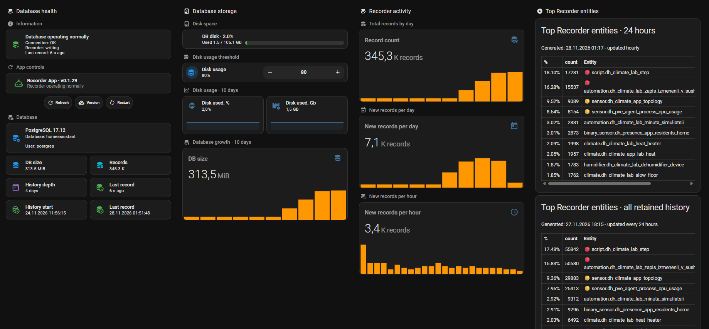

# DigitalHouses Recorder App

[](https://github.com/DigitalHouses/home-assistant-apps/actions/workflows/validate.yml)
[](../LICENSE)


**Understand what is happening inside your Home Assistant Recorder database.**

Monitor database health, disk space, history retention and the entities generating the most records — directly from a Home Assistant dashboard.

## Why I built this app

I've been using Home Assistant and, over time, kept running into the same questions about its Recorder database.

Sometimes I was running out of disk space. Other times the database was growing much faster than I expected, and I had to figure out which entity was responsible. I also wanted to know whether Recorder was still writing data, how much history I actually had, and how quickly the number of records was increasing.

I could investigate these things using SQL queries and server tools, but I wanted to see the answers in Home Assistant itself, without having to investigate the database manually every time.

That's why I built DigitalHouses Recorder App. It started as a practical tool for my own Home Assistant installations, and I decided to make it available to other users who face the same problems.

## What can it tell you?

| Question | What the app shows |
| --- | --- |
| Is Recorder still working? | Database connectivity, write activity and the age of the last recorded state. |
| Why is my database growing? | Database size, historical growth and record counts by hour and day. |
| Which entities produce the most records? | Top-N rankings for the last 24 hours and all retained history, with counts and percentage shares. |
| How much history do I have? | Earliest and latest recorded states, total records and history depth. |
| Am I running out of disk space? | Free and used space, disk usage history and a configurable warning threshold when storage monitoring is available. |

The app monitors Recorder rather than replacing it. It does not delete history, change Recorder's configuration, or modify its database tables. You decide what to do with the information.

## Dashboard



*English dashboard running on Home Assistant with PostgreSQL and Recorder App 0.1.29.*

[View the Russian dashboard screenshot](images/dh_db_monitor.png).

The dashboard brings database health, storage, activity graphs and entity rankings together. Monitoring entities are created automatically through MQTT Discovery. You can also use them in your own dashboards and automations.

- [English dashboard (YAML)](dashboards/en/10_recorder.yaml)
- [Russian dashboard (YAML)](dashboards/ru/10_recorder.yaml)

## Supported databases

| Database | Connection |
| --- | --- |
| SQLite | Default Home Assistant database. No credentials required. |
| MariaDB | Supervisor MariaDB App or an external server. |
| PostgreSQL | Manual server connection. |

SQLite support and the English dashboard are part of the upcoming 0.2.0 release. The current published 0.1.29 release supports MariaDB and PostgreSQL. See [releases](https://github.com/DigitalHouses/home-assistant-apps/releases) for available versions.

## Quick start

1. Make sure MQTT is configured in Home Assistant and a Supervisor MQTT service is available (for example, the Mosquitto broker App).
2. Open **Settings → Apps → App store → Repositories** and add:

   ```text
   https://github.com/DigitalHouses/home-assistant-apps
   ```

3. Install **DigitalHouses Recorder App**.
4. Select the database actually used by Recorder. Configure the connection for PostgreSQL or external MariaDB; SQLite (0.2.0) requires no database credentials.
5. Review the [telemetry policy](../docs/standards/PRODUCT_TELEMETRY_POLICY.md) and enable the statistics consent option to activate the App under the current policy.
6. Start the App. Its monitoring entities appear automatically through MQTT Discovery.

### Add the dashboard

Install the following frontend cards through HACS:

- Mushroom
- Button Card (5.0 or newer)
- Mini Graph Card
- Entity Progress Card

Copy the [English](dashboards/en/10_recorder.yaml) or [Russian](dashboards/ru/10_recorder.yaml) standalone view into your Home Assistant dashboard YAML (as an entry under `views:`). Choose one language, not both. Use the [Recorder package](packages/common/dh_recorder_app.yaml) to retain the monitoring entities in Recorder history, merging its selection with your existing Recorder configuration if necessary.

DigitalHouses Sync is optional. Its current version selects Russian; the English view can be imported manually. No other DigitalHouses products are required for monitoring.

## Privacy and database access

Recorder metrics and database credentials stay local. SQLite is accessed through a read-only configuration mount and read-only database connections, with bounded queries to minimize impact on Recorder. For external databases, use a least-privileged monitoring account.

The current release policy requires explicit consent to minimal usage statistics (product, version and a random installation ID). It does not send your Recorder records, entity IDs, database credentials or monitoring metrics. The app continues to monitor Recorder if the statistics server is temporarily unavailable. See the [telemetry policy](../docs/standards/PRODUCT_TELEMETRY_POLICY.md) and [privacy review](../docs/standards/TELEMETRY_PRIVACY_LEGAL_REVIEW.md).

## Documentation and feedback

- [Technical documentation](DOCS.md) — configuration, MQTT entities, storage monitoring, runtime settings and migration details.
- [Changelog](CHANGELOG.md)
- [Report a bug or suggest a feature](https://github.com/DigitalHouses/home-assistant-apps/issues)

If you've ever had to investigate an unexpectedly large Recorder database, I'd be interested to hear what you found and which metrics would help you.

Licensed under the [MIT License](../LICENSE).
